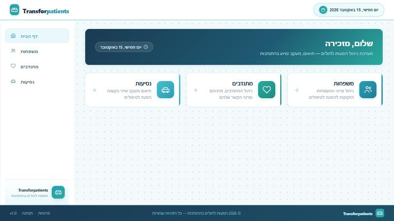
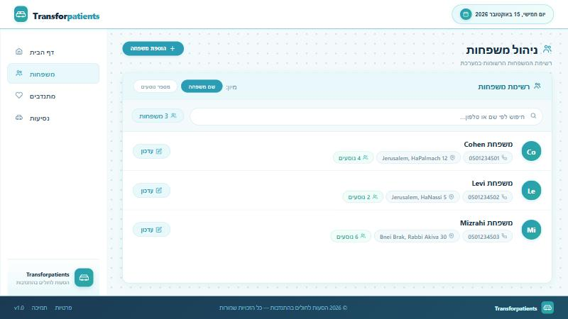
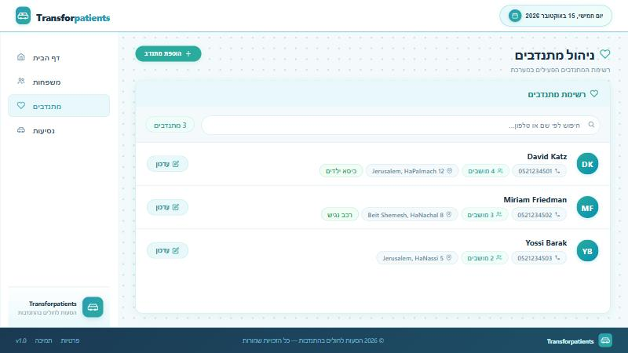
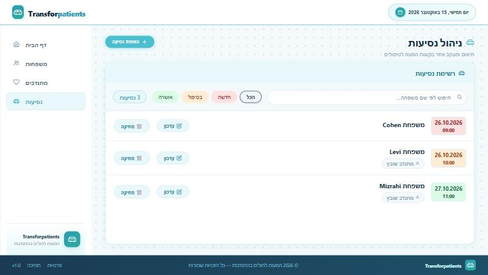

# Transforpatients

A web system for coordinating **volunteer rides for patients and their families** travelling to medical treatments.
A coordinator manages the families that need rides, the volunteer drivers and their availability, and the ride requests that connect them, including recurring (weekly / monthly) rides.

The UI is in Hebrew (RTL).

| Home | Families |
|---|---|
|  |  |
| **Volunteers** | **Rides** |
|  |  |

## Tech stack

- **Backend:** C#, .NET 8, ASP.NET Core Web API, Entity Framework Core, SQL Server (LocalDB), Swagger
- **Frontend:** React 19, TypeScript, React Router, Axios, react-day-picker, date-fns
- **Architecture:** layered backend - `WebApi` (controllers) -> `Bl` (business logic) -> `Dal` (data access / EF Core)

## Features

- Families: add, edit, search, sort by name or number of passengers
- Volunteers: details, car requirements (baby seat, accessibility, seats), active/inactive, free-time slots
- Rides: create, edit, delete, filter by status (new / in progress / approved), recurring rides generated by frequency
- Database is created and filled with fictional demo data automatically on the first run

## Getting started

Prerequisites: [.NET 8 SDK](https://dotnet.microsoft.com/download), [Node.js 18+](https://nodejs.org/), and SQL Server LocalDB (installed with Visual Studio on Windows) or any SQL Server instance.

**1. Backend**

```bash
cd backend/WebApi
dotnet run --launch-profile http
```

The API runs on http://localhost:5102 and Swagger is available at http://localhost:5102/swagger.
On the first run the database `TransforpatientsDB` is created and seeded.
To use a different SQL Server, change `ConnectionStrings:DefaultConnection` in `backend/WebApi/appsettings.json`.

**2. Frontend**

```bash
cd frontend
npm install
npm start
```

Open http://localhost:3000. To point the client at another API address, copy `.env.example` to `.env` and edit `REACT_APP_API_URL`.

## API overview

| Resource | Endpoints |
|---|---|
| Families | `GET /api/Families`, `POST /api/Families`, `PUT /api/Families/{phoneNumber}` |
| Volunteers | `GET /api/Volunteers`, `POST /api/Volunteers`, `PUT /api/Volunteers/{phoneNumber}` |
| Rides | `GET/POST/PUT /api/Rides`, `GET /api/Rides/volunteer/{id}`, `DELETE /api/Rides/{id}` |
| Volunteer free time | `GET/POST/PUT /api/VolunteerFreeTime`, `DELETE /api/VolunteerFreeTime/{id}` |

See Swagger for exact request shapes.

## Tests

```bash
cd frontend
npm test
```

## Project structure

```
backend/
  WebApi/   controllers, startup, configuration
  Bl/       business logic and DTOs
  Dal/      EF Core DbContext, entities, repositories, demo-data seeder
frontend/
  src/pages/        Home, Families, Volunteers, Rides
  src/components/   layout and shared components
  src/services/     API clients (Axios)
  src/models/       TypeScript types
```

## Credits

Built as a team project by Shifra Aisenstain, Hadasa Avichzer, Leah Karpman and Rachel Zeivald.
