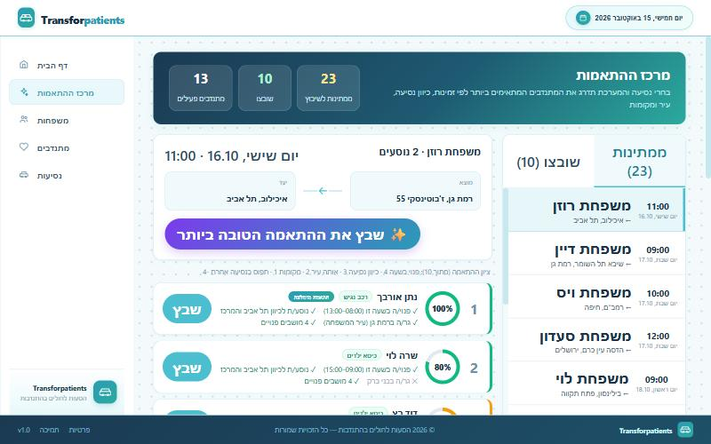

# Transforpatients

A web system for coordinating **volunteer rides for patients and their families** travelling to medical treatments.
A coordinator manages the families that need rides, the volunteer drivers and their availability, and the ride requests that connect them, including recurring (weekly / monthly) rides.

The UI is in Hebrew (RTL).

### Matching center



| Home | Families |
|---|---|
|  |  |
| **Volunteers** | **Rides** |
|  |  |

### AI assistant

| Fill the new-ride form from a pasted message | Explanation and a ready message for the best match |
|---|---|
|  |  |

## Tech stack

- **Backend:** C#, .NET 8, ASP.NET Core Web API, Entity Framework Core, SQL Server (LocalDB), Swagger
- **Frontend:** React 19, TypeScript, React Router, Axios, react-day-picker, date-fns
- **AI (optional):** Gemini through an OpenAI-compatible API, with retries, fallback models and template fallback
- **Architecture:** layered backend - `WebApi` (controllers) -> `Bl` (business logic) -> `Dal` (data access / EF Core)

## Features

- Families: add, edit, search, sort by name or number of passengers
- Volunteers: details, car requirements (baby seat, accessibility, seats), active/inactive, free-time slots
- Rides: origin (defaults to the family's address) and free-text destination, create, edit, delete, filter by status (new / in progress / approved), recurring rides generated by frequency
- **Matching center:** pick a ride and see every active volunteer ranked by a 0-100% match score with the reasons (free at that time, driving in the right direction, same city, enough seats, not busy with another ride); propose a volunteer with one click (the ride moves to "in progress" until the volunteer answers), contact the volunteer by phone or a pre-written e-mail with the ride details, then confirm the ride when the volunteer agrees or remove the volunteer if not
- Volunteer availability: each free-time slot has a free-text destination (the direction the volunteer is driving), shown on the volunteer list and managed on the volunteer's page
- **AI assistant (optional):** paste a free-text request (for example from WhatsApp) to fill the new-ride form, and get an explanation of the best volunteer match with a ready message to send (copy or WhatsApp). The AI only phrases and extracts; the ranking stays in the app, and templates are used when the AI is unavailable. See [docs/AI-ASSISTANT.md](docs/AI-ASSISTANT.md)
- Database is created and filled with a large set of fictional demo data (14 families, 14 volunteers, ~40 availability slots, 33 rides) automatically on the first run

## Getting started

Prerequisites: [.NET 8 SDK](https://dotnet.microsoft.com/download), [Node.js 18+](https://nodejs.org/), and SQL Server LocalDB (installed with Visual Studio on Windows) or any SQL Server instance.

**1. Backend**

```bash
cd backend/WebApi
dotnet run --launch-profile http
```

The API runs on http://localhost:5102 and Swagger is available at http://localhost:5102/swagger.
On the first run the database `TransforpatientsDB` is created and seeded. The schema is created with `EnsureCreated`, so after pulling a version with schema changes drop the database (`DROP DATABASE TransforpatientsDB`) and run again.
To use a different SQL Server, change `ConnectionStrings:DefaultConnection` in `backend/WebApi/appsettings.json`.

Optional - enable the AI assistant with a free key from Google AI Studio (kept in user secrets, never in the repository):

```bash
dotnet user-secrets set "Llm:ApiKey" "<your key>" --project WebApi
```

**2. Frontend**

```bash
cd frontend
npm install
npm start
```

Open http://localhost:3000. To point the client at another API address, copy `.env.example` to `.env` and edit `REACT_APP_API_URL`.

## How the match score works

For a ride, each active volunteer gets up to 10 points (shown as a percentage):

| Criterion | Points |
|---|---|
| Has a free-time slot covering the ride time | 4 |
| The slot's direction matches the ride destination (same place or same region) | 3 |
| Lives in the family's city | 2 |
| Has enough seats for the family | 1 |
| Already has another ride within 2 hours | -4 |

The logic lives in `frontend/src/utils/matching.ts`.

## API overview

| Resource | Endpoints |
|---|---|
| Families | `GET /api/Families`, `POST /api/Families`, `PUT /api/Families/{phoneNumber}` |
| Volunteers | `GET /api/Volunteers`, `POST /api/Volunteers`, `PUT /api/Volunteers/{phoneNumber}` |
| Rides | `GET/POST/PUT /api/Rides`, `GET /api/Rides/volunteer/{id}`, `DELETE /api/Rides/{id}` |
| AI assistant | `POST /api/rides/parse-request`, `POST /api/rides/explain-match` |
| Volunteer free time | `GET/POST/PUT /api/VolunteerFreeTime`, `DELETE /api/VolunteerFreeTime/{id}` |

See Swagger for exact request shapes.

## Tests

```bash
cd frontend
npm test
```

Backend (the AI client, the request parser and the match explainer, with a fake AI, no key needed):

```bash
cd backend
dotnet test Bl.Tests
```

## Project structure

```
backend/
  WebApi/   controllers, startup, configuration
  Bl/       business logic and DTOs
  Dal/      EF Core DbContext, entities, repositories, demo-data seeder
  Bl.Tests/ unit tests of the AI client, request parser and match explainer
frontend/
  src/pages/        Home, Families, Volunteers, Rides
  src/components/   layout and shared components
  src/services/     API clients (Axios)
  src/models/       TypeScript types
```

## Credits

Built as a team project by Shifra Aisenstain, Hadasa Avichzer, Leah Karpman and Rachel Zeivald.
