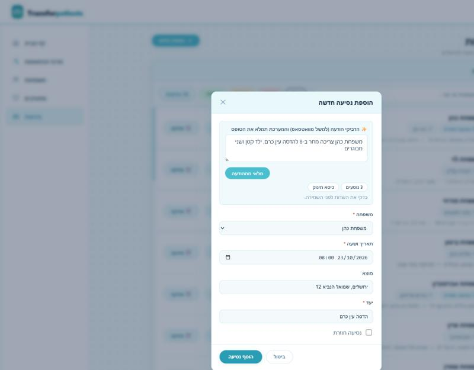
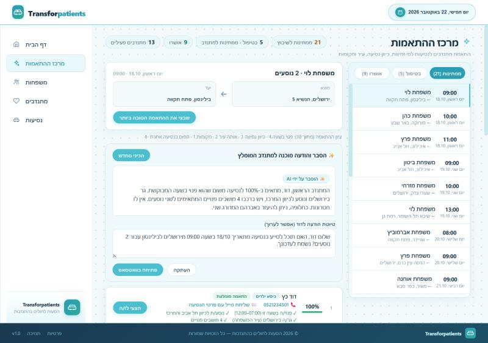

# AI assistant for ride coordination

Two features that save the coordinator typing and writing, built on a free Gemini key (any OpenAI-compatible service works).

1. **Request intake from free text.** In "הוספת נסיעה", paste a message (for example from WhatsApp) such as
   *"משפחת כהן צריכה מחר ב-8 להדסה עין כרם, ילד קטן ושני מבוגרים"* and press "מלאי מההודעה". The family, date and time, destination
   and recurrence are filled in, the origin defaults to the address of the family, and the number of passengers, baby seat and
   accessible car are shown as chips. The AI never guesses: whatever the message does not say stays empty and is listed as missing.
2. **Explanation and message for the best match.** In the matching center, for a ride without a volunteer, "הכיני הסבר והודעה" explains
   in a few sentences why the top volunteer fits (and what is missing, and who is the alternative), and drafts a message to the volunteer
   that can be edited, copied or opened in WhatsApp.

| Request intake | Match explanation |
|---|---|
|  |  |

## The AI does not choose the volunteer

The ranking and the percentages are computed by the app (`frontend/src/utils/matching.ts`). The AI only **phrases** that result and
**extracts fields** from text. It cannot change the ranking. When there is no key, or the AI service is busy or slow, the same texts are built
from templates and the badge on the screen reads "הסבר אוטומטי" instead of "✨ הוסבר על ידי AI".

## Privacy

The server sends to the AI only first names of volunteers, the reasons of the match, the date and the *first part* of the origin and
destination (the city / hospital, not the street and not the department). It never sends phone numbers, family names, street addresses
or medical departments. This is covered by unit tests (`MatchExplainerTests`, `aiAssistant.test.ts`).

## Setup

Get a free key in [Google AI Studio](https://aistudio.google.com/) and keep it on your machine only. **The key is never stored in the repository**:

```bash
cd backend
dotnet user-secrets set "Llm:ApiKey" "<your key>" --project WebApi
```

Other settings are in `backend/WebApi/appsettings.json` (section `Llm`): `BaseUrl`, `Model`, `FallbackModels`, `ReasoningEffort`,
`TimeoutSeconds` and `TotalTimeoutSeconds`. To use another provider (OpenAI, or a local Ollama at `http://localhost:11434/v1/`) change `BaseUrl`
and `Model`.

The client retries when the service is busy, moves to the next model of `FallbackModels` when a model is rate limited or retired, and gives up
after `TotalTimeoutSeconds`, so the screen never waits long. Free keys have rate limits and the service is sometimes slow; the templates cover that.

## Endpoints

- `POST /api/rides/parse-request` with `{ "text": "..." }` returns the extracted fields, a list of missing fields and warnings.
- `POST /api/rides/explain-match` with the ride and the ranked candidates returns `{ summary, volunteerMessage, fromLlm }`.

## Tests

```bash
cd backend && dotnet test Bl.Tests     # 34 tests, with a fake AI, no key needed
cd frontend && npm test
```
